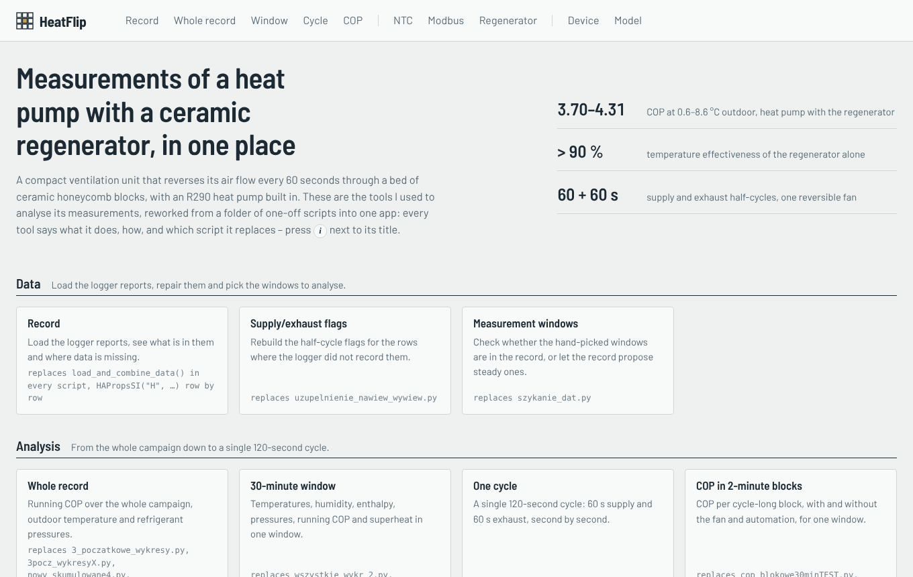
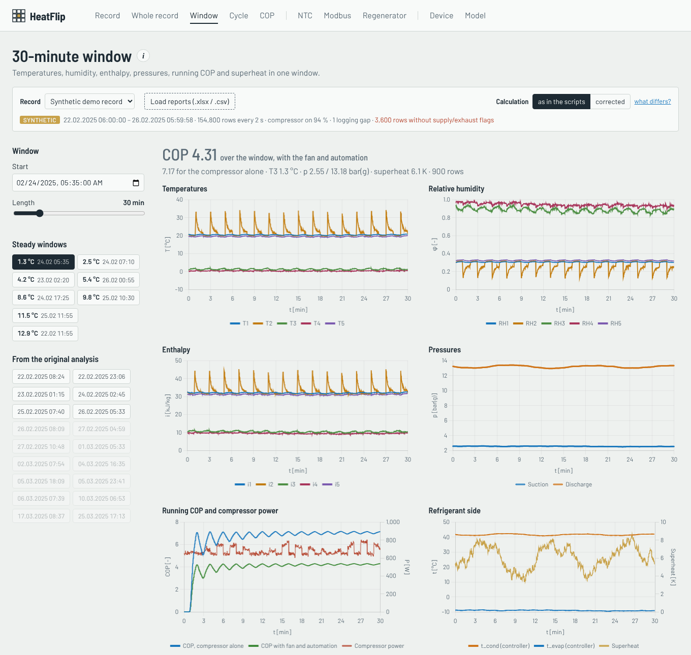
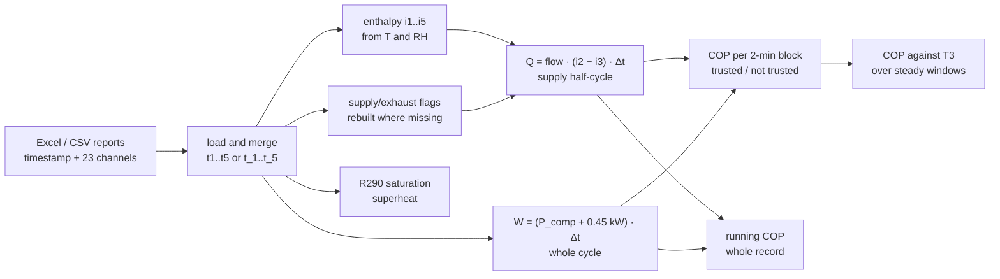
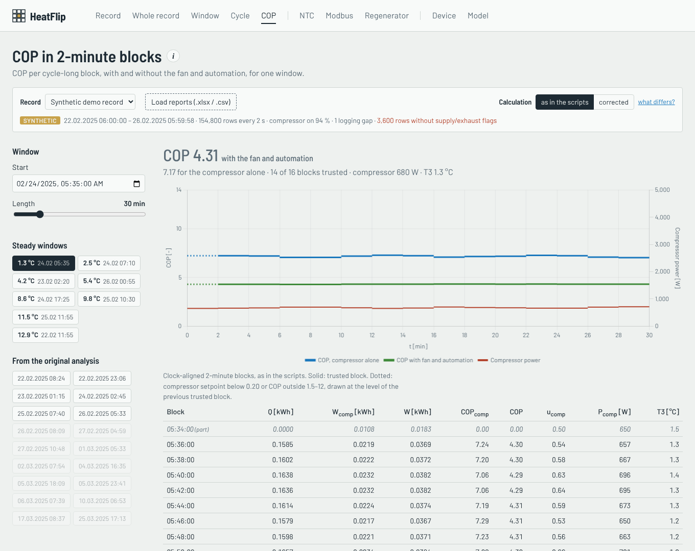
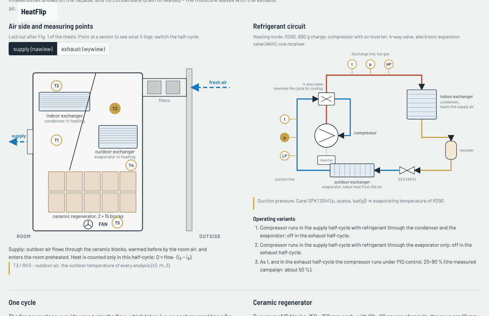

# HeatFlip Ceramic

**From the logger report to the COP: measurements of a reversible ventilation unit with a ceramic regenerator and an R290 heat pump.**
A FastAPI + Angular app built on my master's project thesis at Politechnika Warszawska (MEiL, Zakład Chłodnictwa i Energetyki Budynku):

> *„Analiza eksperymentalno-symulacyjna układu HVAC z blokami ceramicznymi: bilans cieplny, spadki ciśnienia i rekomendacje sterowania”*
> (Experimental and simulation analysis of an HVAC unit with ceramic blocks: heat balance, pressure drops and control recommendations)



## Why

The unit is a compact ventilation device with no outdoor part. One reversible fan pushes the air in and out through a bed of
ceramic honeycomb blocks, changing direction every 60 s. The ceramic stores the heat of the exhaust air and gives it back to
the fresh air, and an R290 heat pump is built into the same casing. On the test stand a controller logged temperatures and
humidities at five points, the refrigerant pressures and the compressor power every two seconds, over a month of operation.

All of the analysis lived in a folder of one-off scripts, the first Python code I wrote. Each had its own hard-coded file paths, measurement windows and
constants, wrote SVG files into `python_test/runN`, and some of them disagreed with each other. HeatFlip replaces them with
one app: every tool says what it does, how, and which script it replaces (the **i** next to its title), the calculations
are tested against the numbers printed in the thesis, and the places where the scripts slipped are fixed in a separate,
switchable mode.

## What it does

| Tool | | Replaces |
|---|---|---|
| **Record** | Load the Excel/CSV reports (both column-naming variants, several files merged in time order), channels and their completeness, logging gaps. | `load_and_combine_data()` in every script |
| **Supply/exhaust flags** | Rebuild the half-cycle flags where the logger did not record them, checked against the supply-air temperature. | `uzupelnienie_nawiew_wywiew.py` |
| **Measurement windows** | Check the hand-picked 30-minute windows against the record, or let it propose steady windows across the outdoor-temperature range. | `szykanie_dat.py` |
| **Whole record** | Running COP over the campaign, outdoor temperature, pressures; compressor stops and logging gaps marked. | `3_poczatkowe_wykresy.py`, `nowy_skumulowane4.py`, `skumulowany_5najnowszy.py` |
| **30-minute window** | T, RH and enthalpy at the five points, pressures, running COP, R290 saturation temperatures and superheat. | `wszystkie_wykr_2.py`, `dodatkowe_COP.py`, `wszystkieBezCOP2.py` |
| **One cycle** | One 120 s cycle second by second, heating capacity and power, the cycle COP. | `120sPRZEDZIALY_new.py` |
| **COP in 2-minute blocks** | The COP plots of the thesis, with and without the fan and automation; untrusted blocks marked. COP against outdoor temperature over the steady windows. | `cop_blokowe30minTEST.py`, `cop_blok30min_nowszy.py` |
| **NTC characteristic** | Current or resistance to temperature: the datasheet table, Beta and Steinhart–Hart fits, B constants. | `NTC5k_characterisitc.py` |
| **Modbus RTU** | Find the controller on the RS-485 bus, read and write registers, every frame byte by byte with its CRC. A simulated controller when no port is configured. | `szukanie_modnusa.py`, `Zmiana_rejestrow.py` |
| **Ceramic regenerator** | Channel geometry, heat transfer, pressure drop, fan power and time constants of the blocks, next to the values printed in the thesis. | section 4.4 of the thesis |
| **Device and Model** | Schematics of the unit, the R290 circuit, one cycle and the measuring chain; the calculation chain, the audit and the sources. | figures of the thesis and the paper |

<p align="center"></p>

## How it works



Air at each point (ASHRAE Fundamentals, Hyland–Wexler over water), checked against the CoolProp `HAPropsSI` the scripts
called row by row – within 0.15 kJ/kg, and within 0.05 kJ/kg on the difference that enters the balance:

```math
x = 0.621945\,\frac{\varphi\,p_{ws}(t)}{p - \varphi\,p_{ws}(t)}, \qquad
i = 1.006\,t + x\,(2501 + 1.86\,t) \quad [\mathrm{kJ/kg}]
```

Heat only in the supply half-cycle, electrical energy over the whole cycle:

```math
Q = \dot m\,(i_2 - i_3)\,\Delta t, \qquad W = (P_{comp} + P_{aux})\,\Delta t, \qquad
\mathrm{COP}_{block} = \frac{\sum Q}{\sum W}
```

A block is trusted when its highest compressor setpoint is at least 0.20 and its COP lies between 1.5 and 12.

<p align="center"></p>

## Scripts vs corrected

By default every tool computes exactly what the scripts computed, so the results match the thesis. The **corrected** switch
fixes what changes numbers:

| | As in the scripts | Corrected | Effect |
|---|---|---|---|
| Air flow in $`Q = \dot m\,\Delta i`$ | 0.389 – the volume flow, 1400 m³/h in m³/s | the mass flow, 0.468 kg/s (as in the thesis text) | Q and COP × 1.20 |
| Constant 0.45 kW in the running COP | added on exhaust rows only | on every row, as the block scripts did | whole-record COP lower |
| Time step after a logging gap | the first row after a gap carries the whole gap | capped at 10 s | no jump after weekend breaks |
| Block boundaries | clock-aligned 2-minute bins | one block per cycle, from its supply start | blocks are true cycles |

Fixed in both modes or shown in their tools: the rebuilt flags no longer drift by one sample per half-cycle, the NTC tool
shows that linear interpolation in R reads 0.4–0.7 K warm between table points 10 K apart, and the regenerator tool
puts the time constant of the thesis, $`\tau = C/(hA) \approx 12.5`$ s, next to the time scale set by the air,
$`C/(\dot m c_p) \approx 200`$ s, which is what limits how fast the bed charges at NTU ≈ 16. The full audit is on the
Model page.

<p align="center"></p>

## Running it

With Docker:

```bash
docker compose up --build        # http://localhost:8080
```

For development:

```bash
cd backend
pip install -r requirements-dev.txt
uvicorn app.main:app --reload    # API on :8000, docs at /docs
pytest -q

cd ../frontend
npm ci
npx ng serve --proxy-config proxy.conf.json   # http://localhost:4200
```

The Modbus tool talks to a simulated controller unless the API is started with a serial port:

```bash
MODBUS_PORT=/dev/ttyUSB0 MODBUS_BAUDRATE=19200 MODBUS_PARITY=N uvicorn app.main:app
# writing registers on a real port also needs MODBUS_ALLOW_WRITE=1
```

## Data

The measurement data of the test stand is not part of this repository; the app starts on a synthetic record in exactly the
logger layout (2 s sampling, 60 s half-cycles, a compressor stop, a logging gap, flags missing at the start), shaped after the
measured behaviour. Real reports are loaded in the browser and stay in the memory of the API process.

The reports have a timestamp `dd.mm.yyyy HH:MM:SS` and the columns
`t1…t5, rh_1…rh_5, t_ssania, t_tloczenie, p_ssania, p_tloczenia, t_parowania, t_skraplania, Moc_Czynna, Moc_Bierna,
Moc_Pozorna, predkosc_wentylatora, nast_spr, nawiew, wywiew`; files without headers are read by column position.

## API

Everything is plain JSON under `/api/v1` (OpenAPI docs at `/docs`):

| | |
|---|---|
| `GET /datasets`, `POST /datasets` | records in memory; upload reports (multipart) |
| `POST /datasets/{id}/blocks` | COP per block for a window |
| `POST /datasets/{id}/cumulative` | running COP over the record |
| `POST /datasets/{id}/window` | all channels, enthalpies, running COP, superheat for a window or one cycle |
| `GET /datasets/{id}/phases`, `POST …/phases/preview`, `POST …/phases/apply` | rebuild the supply/exhaust flags |
| `POST /datasets/{id}/windows/check`, `GET …/windows/suggest` | measurement windows |
| `POST /datasets/{id}/cop-vs-tout` | COP against outdoor temperature |
| `POST /ntc` | NTC characteristic |
| `GET /modbus`, `POST /modbus/read`, `/write`, `/scan` | Modbus RTU |
| `POST /regenerator` | ceramic regenerator |

Every COP endpoint takes `"cop": {"mode": "scripts" | "corrected"}`.

## Layout

```
backend/app/core     psychro, dataset, cop, window, windows, phases, r290, ntc, modbus, regenerator, synthetic
backend/app/data     device, NTC table, values printed in the thesis
backend/tests        pytest, values checked against the thesis and the scripts
frontend/src/app     pages per tool, shared chart and info components
```

## Sources

- K. Katana, A. Grzebielec, A. Szelągowski, M. Kruk, K. Bruzi, *Experimental study of a reversible ventilation–heat pump
  system with a ceramic regenerator*, Archives of Thermodynamics 47(1), 2026
- ASHRAE Handbook – Fundamentals, ch. 1 Psychrometrics, 2017
- I. H. Bell et al., *Pure and pseudo-pure fluid thermophysical property evaluation and the open-source thermophysical
  property library CoolProp*, Ind. Eng. Chem. Res. 53 (2014) 2498–2508
- R. K. Shah, A. L. London, *Laminar Flow Forced Convection in Ducts*, Academic Press, 1978
- J. S. Steinhart, S. R. Hart, *Calibration curves for thermistors*, Deep-Sea Research 15 (1968) 497–503
- PN-EN 13141-8:2014; IEC 60539-1:2022; Modbus over Serial Line V1.02; JCGM 100:2008

## License

MIT
